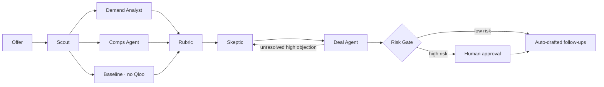

# Headcount

> Know who'll show up before you sign the offer.

Headcount is a multi-agent decision tool for **independent promoters and venue talent buyers**. Give it an act, a city, a room size and the guarantee you're about to offer. Agents grounded in **Qloo's taste graph** measure how much that city's audience actually loves the act, argue about it, and return **GO / RESIZE / PASS** with a room size, a guarantee ceiling, local co-bills, sponsor targets and promo spots. Risky offers pause for a human.

Built for the [Qloo Agentic Hackathon](https://qloo.devpost.com/).

## Why
- 64% of US independent stages operated without profit in 2024 ([NIVA State of Live, via Pollstar](https://news.pollstar.com/2025/06/23/nivas-state-of-live-survey-finds-independent-venues-generated-153-1b-in-total-economic-output-across-u-s-in-2024-64-stages-struggling-with-unprofitability)).
- 56% of independent operators report advance ticket sales down year over year, and ticket sales are their #1 bottom-line pressure ([NIVA × Bandsintown, 2026](https://www.hypebot.com/niva-bandsintown-survey-tracks-state-of-indie-live-events/)).
- A weak night on a flat guarantee can end ~$1,500 down, roughly a good night's profit at a 500-cap room ([TickPick](https://www.tickpick.com/blog/organizer/how-event-promoters-make-money)).
- Existing tools answer "where are this artist's fans?" (streaming data) or "how did similar shows sell?" (ticket history). Both are thin for regional and developing acts and first plays in a market. Headcount asks a different question: **does this city's taste match this act?** That's the question Qloo's graph can answer.

## What makes it Qloo-powered
Every offer makes **7 Qloo calls across 6 query types**. Remove Qloo and nothing is left to reason over.

| Agent | Qloo call | What it's used for |
|---|---|---|
| Scout | `GET /search` (`types=urn:entity:artist`) | Resolve the act to a Qloo entity; exact-name match first, then popularity; genre tags and image |
| Demand Analyst | `GET /v2/insights` `filter.type=urn:heatmap` (US) | Thousands of geohash cells of taste affinity. Headcount maps each of **105 US metros** to its cell, ranks metros against each other → **metro demand percentile**, plus a **hype gap** (popularity − affinity) |
| Comps Agent | `GET /v2/insights` `urn:entity:artist` (taste signal) | Acts with the same audience |
| Comps Agent | `GET /v2/insights` `urn:entity:artist` (`filter.tags` = act's two most specific genres + `signal.location`) | Co-bill pool: acts in this genre that this metro's audience loves |
| Comps Agent | `GET /v2/insights` `urn:entity:place` (`filter.location`) | Where this audience already goes locally → street-team / poster spots |
| Comps Agent | `GET /v2/insights` `urn:entity:brand` | Brands this audience over-indexes on → sponsor targets |
| Comps Agent | `GET /v2/insights` `urn:demographics` | Age and gender skew of the audience ("who's in the room") |

A **Baseline** agent answers the same offer with **no Qloo data** (same model), and the UI shows both side by side, so you can see what the data changed.

## How it works

- **Orchestration:** LangGraph (parallel fan-out, a Skeptic ⇄ Deal rebuttal loop, `interrupt()` for human approval).
- **Rubric (deterministic):** demand factor = percentile ÷ 75 (min 0.25, max 1). Recommended room and guarantee ceiling = proposal × factor. Below the 10th percentile → PASS. No heatmap cell → PASS with a "thin data" flag, never a made-up number. *Assumption, shown in the UI:* the proposed room is sized for the act's typical strong market.
- **Skeptic (Gemini 3.1 Pro):** attacks the draft using only the evidence. **Deal Agent (Gemini 3.1 Pro):** arbitrates. It may move the verdict at most one step, and code-level guard rails clamp its numbers and strip any co-bill, sponsor or venue that didn't come from Qloo.
- **Risk Gate (graduated autonomy):** auto-runs when the exposure is small or the demand is very strong. It pauses for a human when the guarantee is above $50K, above $25K with demand under the 90th percentile, when the Skeptic and Deal Agent still disagree, when passing on a major act, or when the arbiter had to override the Deal Agent.
- **Audit trail:** every run is written to Firestore with each agent step, each Qloo endpoint called (status, latency, and why), and the human decision.

## Honest limits
- Qloo measures **taste affinity, not ticket sales**. Headcount doesn't forecast tickets; it scales a proposal by how strong the local taste signal is relative to the act's best markets.
- Follow-ups (hold request, opener shortlist, sponsor list, promo plan) are **drafts**. Headcount never sends anything.
- LLM verdicts can vary run to run. The landing-page scenario cards replay **recorded live runs** (labelled as replays, at 2×) so judges see the same behavior every time; "run live" and custom offers always run live.
- The API runs on a single Cloud Run instance with in-memory checkpoints: a restart drops a run that's waiting for approval (its audit record survives).
- Qloo responses are cached and stored only server-side (Firestore), never in this repo.

## Run it
```bash
cp .env.example .env          # QLOO_API_KEY (hackathon key), GEMINI_API_KEY
cd api && uv sync
uv run pytest -q              # 19 tests: metro math, rubric, guard rails, risk gate, full graph with fakes
uv run python -m headcount.cli "Japanese Breakfast" "Tulsa, OK" 2800 40000
uv run uvicorn headcount.main:app --reload
```
API: `POST /runs` · `GET /runs/{id}/stream` (SSE) · `POST /runs/{id}/decision` · `POST /replays/{key}` · `GET /metros`

## Stack
Python 3.12 · FastAPI · LangGraph · Gemini 3.8 Flash / 3.1 Pro · Qloo Taste AI (hackathon API) · Firestore · Cloud Run · frontend built with Lovable (React + Tailwind).

## License
MIT
